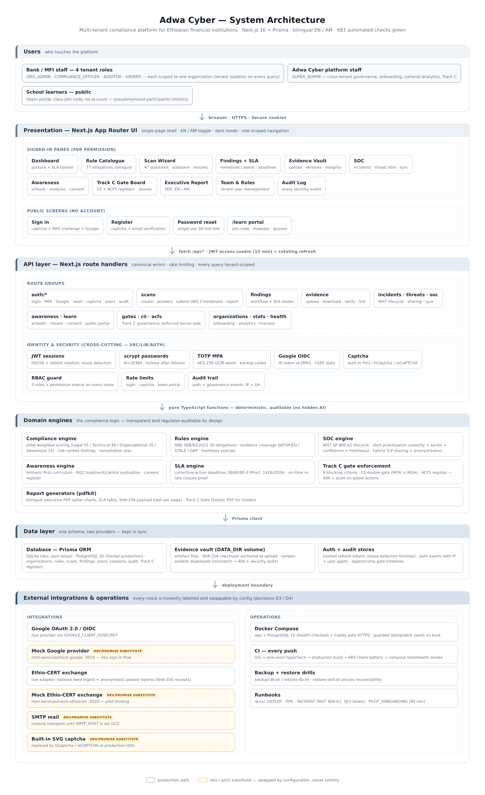

# Adwa Cyber — Compliance Platform (Phase 1 MVP)

Automated compliance assessment against the **47 obligations of the Ethiopian
Personal Data Protection Proclamation No. 1321/2024**, with a security-hardened
multi-tenant identity layer.

Bilingual (English / አማርኛ) · Proclamation 1321/2024 · NCSP 2024 · Digital Ethiopia 2030

## What is implemented

| Module | Details |
|---|---|
| **Authentication** | Password sign-in (scrypt, N=16384), JWT access cookies (HS256, 15 min) + rotating opaque refresh tokens with reuse detection & family revocation; logged-in password change re-authenticates with the current password and revokes every session |
| **Account recovery** | Self-service password reset (30-min single-use SHA-256-hashed tokens, enumeration-resistant) + email verification (24 h); sessions fully revoked on reset; pluggable mail transport (SMTP or console) |
| **MFA (OTP)** | RFC 6238 TOTP (Google Authenticator / Authy / Aegis), QR enrollment, AES-256-GCM encrypted secrets, replay protection, 8 single-use backup codes |
| **Sign in with Google** | OAuth 2.0 / OIDC authorization-code flow, state-CSRF cookie, ID token verified against Google's JWKS, domain-restricted auto-provisioning — the step-by-step production setup (Google Cloud Console, redirect URI, provisioning policy, troubleshooting) is `docs/GOOGLE_SSO_SETUP.md` |
| **Captcha** | Built-in distorted SVG captcha (single-use server-side challenges) on login & registration; pluggable hCaptcha / reCAPTCHA |
| **Multi-tenant RBAC** | 5 roles — SUPER_ADMIN, ORG_ADMIN, COMPLIANCE_OFFICER, AUDITOR, VIEWER — permission matrix, every query scoped by `organizationId` |
| **47-rule catalogue** | The obligations of Proclamation 1321/2024 as machine-readable rules (bilingual statements, questions, check logic, remediation, penalty refs, pillars, severity, priority) |
| **Compliance engine** | Pillar-weighted scoring (Legal 35% / Technical 30% / Organisational 20% / Awareness 15%), risk-ranked findings, predictive violation detection, prioritised remediation plan, RQ1 audit-time comparison |
| **Findings workflow** | open → in_progress → remediated / waived, tenant-isolated |
| **Remediation SLA** | Severity-based corrective-action deadlines (critical 30d / high 60d / medium 90d, Procl. 1426/2026 practice), on-time vs late closure proof, overdue tracking, dashboard banner |
| **Rules engine** | NBE-IT SBB/83/2022 30-obligation catalogue, evidence coverage (SATISFIED/STALE/GAP), freshness policies, evidence↔obligation links with AUTO_TAG |
| **VAPT Center (NBE LOT4)** | Vulnerability assessment & pen-test platform per the NBE/NCB/S/02/2026/27 LOT4 tender: attack-surface registry (managed + shadow-IT EASM via live certificate-transparency + DNS), hybrid engine — REAL non-destructive DAST web checks (OWASP A02/A05/A07, throttled, proof bundles), REAL credentialed audits (SNMP v1/v2c/v3 device audit, MongoDB + MariaDB wire-protocol logins, encrypted credential store) and honestly-labelled reference CVE catalogue — live FIRST EPSS at scan time + CVSS + CISA-KEV + business-context dynamic prioritisation (P1–P4), remediation SLA (30/60/90/180d), and promotion of criticals into the Findings module as NBE-anchored corrective actions (bidirectional status sync; mirror scans excluded from compliance aggregates). Plus **AD Attack Paths** (BloodHound-style CBE.LOCAL graph — 15 nodes/19 edges, BFS multi-hop breach→Domain-Admin/DC paths, chokepoints, interactive SVG) and the **Bid Matrix** (all 66 tender requirement lines with honest full/partial/roadmap responses, CSV export shaped for the SBD Vendor-Response form) |
| **Executive PDF** | Server-side bilingual (EN/አማርኛ) pdfkit reports with pillar charts, SLA table, per-page footers + payload hash |
| **SOC / CERT-as-a-Service** | Phase 2 pilot: threat-intelligence hub with **live public-feed connectors** (CISA KEV, abuse.ch URLhaus + ThreatFox, Spamhaus DROP, AlienVault OTX pulses — no-key/keyed free feeds, honestly labelled LIVE/SNAPSHOT with as-of dates), GreyNoise scanner classification + VirusTotal reputation enrichment, self-hosted **MISP private exchange** connector (TLP:AMBER+/RED stay in-tenant), hybrid sharing (anonymised hub broadcasts + peer-to-peer for sensitive indicators, AAU framework), NIST SP 800-61 incident lifecycle (detect → triage → contain → eradicate → recover → close), alert prioritisation, predictive threat forecast, automated containment, Ethio-CERT synchronisation (national-feed ingest + anonymised upward reports with sha256-proof payloads), RQ3 detection→notification latency tracking (<15 min median target) |
| **Ethiopian cyber landscape** | Real national sources, live-verified: the Ethio-CERT public API adapter (advisories, alerts, news, regulations, GCI — bilingual EN/አማርኛ with 60s cache, labelled-snapshot degradation), the INSA home-page headline parser, the 9-instrument national cyber legal corpus with official PDFs, ITU GCI 2024 pillars + 2014→2024 trajectory, NBE directives, hotline 933 — surfaced as a dashboard panel + an Ethiopian layer in the intel ribbon (each fact carries its source URL and provenance tier; `bun run ethio:snapshot` refreshes the bundled snapshots from the live sources) |
| **Awareness platform** | Phase 3 (Track B): Amharic-first cyber-safety curriculum (8 bilingual units, 32 quiz items) for the five-school Addis Ababa pilot, pseudonymised minor participants, parental-consent register, RQ2 treatment/control evaluation, public learner portal + safe-browsing tools |
| **Scan integrity (WS-2)** | Submission requires 100% explicit answers (INCOMPLETE lists the missing codes — a partial submission can never inflate a score), every N/A needs a ≥5-char justification (decision D1), duplicates/unknown rules/invalid values rejected, all writes in one transaction; drafts autosave per-question with `answeredAt` tracking so an intentional N/A survives resume |
| **Track C gate board** | Phases 4–5 governance (ACFS content filtering + CII protection): 8 blocking gate criteria with forward-only status lifecycle, evidence-backed satisfaction (SHA-256-sealed artefacts, refusals without one), append-only per-criterion timeline, funder-facing Gate Dossier PDF (EN/አማርኛ) — deployment stays locked until every blocking criterion is satisfied |
| **CII monitoring register (P5)** | 4 named operators (EEP, Ethio Telecom, CBE, Ethiopian Airlines), MOU version lifecycle (DRAFTING→…→ACTIVE), INSA authorisation tracking, registered-system readiness ladder; monitoring is doubly gated per operator (in-force MOU + ACTIVE INSA licence) and advancing a system to MONITORING_AUTHORIZED on a shut gate is refused with 409; tenants get a read-only feed of their own operator |
| **ACFS precondition register (P4)** | 13 preconditions across 4 domains (EMA partnership, EHRC due diligence, transparency framework, dedicated funding) with SATISFIED-requires-evidence rule, periodic board decisions (REMAINED_LOCKED/UNLOCKED), server-side unlock enforcement — register currently LOCKED |
| **UI** | Modern per-module shell: each tab themed to its name (palette, iconography, wording), animated 3D ops background (cyber-canvas), a real-intel ticker of 16 verifiable published facts (NIST, CIS, OWASP, FIRST, CISA, Verizon DBIR, IBM) interleaved with the Ethiopian national layer, EN/AM toggle, dark mode |
| **Production bindings console (Phase 3)** | One honest surface for every external integration — the **System Bindings** tab (SUPER_ADMIN), `GET /api/system/bindings` and `bun run bindings:report`: 14 bindings across identity (Google SSO), mail (SMTP), national (Ethio-CERT exchange + public web), threat intel (KEV/DROP/URLhaus/ThreatFox/OTX/MISP), enrichment (GreyNoise/VirusTotal) and VAPT (live EPSS + offline-first catalogue), each with a closed-set status (live/mock/fixture/snapshot/unconfigured/disabled), the exact env vars that flip it to production, as-of dates and refresh commands — secrets never leave the server (docs/PRODUCTION_BINDINGS.md) |
| **Audit trail** | Every auth event (logins, MFA, lockouts, token reuse, user CRUD, Google logins) persisted with IP + user agent |

See `docs/AUTH.md` for the full identity-module reference (API surface,
permission matrix, OWASP hardening notes).

## System architecture



Six layers, top to bottom: **users** (tenant staff in 4 roles, platform staff,
public learners) → **presentation** (one bilingual SPA with role-scoped panes
plus public auth/learner screens) → **API + identity** (route handlers with
RBAC guard, JWT session rotation, MFA, captcha, rate limits, audit on every
call) → **domain engines** (pure TypeScript organized as domain modules —
`src/lib/{compliance, vapt, soc, ethio, awareness, governance}`: compliance,
rules, VAPT engines + connectors, SOC + threat-intel connectors, Ethiopian
ecosystem adapters, awareness, SLA, Track C gate enforcement, PDF
generators — deterministic and regulator-auditable by design) → **data**
(Prisma over SQLite/PostgreSQL, SHA-256-anchored evidence vault, audit
stores) → **integrations & operations** (Google OIDC, Ethio-CERT public API +
exchange, public threat feeds, MISP, SMTP, captcha providers, Docker
Compose + Caddy TLS, CI, backup/restore drills). Everything drawn with a
**dashed amber border is a dev/pilot substitute** — honestly labelled and
swapped by configuration, never silently (decisions D3/D4).

The full architecture reference — domain module map, the invariants that
must survive every change (honesty pattern, authorization-first, tenant
isolation, hash-chained audit), the connector pattern, and the **scaling
evolution plan** (what to change when load grows: PostgreSQL, Redis,
sync workers, scan workers, and the post-pilot refactoring roadmap) — is
`docs/ARCHITECTURE.md`. Regenerate the diagram with
`python3 scripts/render-architecture.py` (source:
`scripts/architecture-diagram.html`).

## Tech stack

Next.js 16 (App Router) · TypeScript · Prisma (SQLite dev DB, PostgreSQL-ready) ·
Tailwind CSS 4 + shadcn/ui · jose (JWT) · Node crypto (scrypt, AES-256-GCM, TOTP)

## Quick start

```bash
bun install

# .env needs DATABASE_URL and AUTH_SECRET (64+ chars) — see .env.example
bunx prisma db push             # create schema
bun run seed:demo               # catalogue + demo accounts + evidence + SOC +
                                 #   VAPT + awareness RCT + SLA + gates + Track C
bun run dev                     # http://localhost:3000
```

`seed:demo` chains: `db:seed` (77 rules + pilot orgs + demo scans) →
`seed:users` → `seed:evidence` → `seed:evidence-links` → `seed:soc` →
`seed:vapt` → `seed:awareness` → `seed:sla` → `seed:gates` → `seed:trackc` →
`seed:gate-evidence`. Every step is idempotent, and all of them refuse to run
against `NODE_ENV=production` unless `SEED_ON_BOOT=1` (bootstrap) or
`ALLOW_DEMO_SEED=1` (full demo) is set — decision D6, `docs/DECISIONS.md`.

Optional: `cd mini-services/mock-google && bun run dev` starts the mock Google
OAuth/OIDC provider on :3010 so the full Google sign-in flow can be exercised
without real credentials (enabled via `GOOGLE_*` overrides in `.env`).

Refresh the bundled live-source snapshots (offline fallbacks) any time:

```bash
bun run vapt:epss          # NVD + FIRST EPSS + CISA KEV → src/lib/vapt/vapt-feed-snapshot.json
bun run intel:snapshots    # CISA KEV + Spamhaus DROP → src/lib/soc/intel-snapshots/
bun run ethio:snapshot     # Ethio-CERT public API + INSA → src/lib/ethio/ethio-snapshots/
bun run bindings:report    # production bindings registry — the pre-boot
                           #   go-live checklist (env var names only, never values)
```

The runbook for repeating the full self-scan demo (vuln-lab target, exact
steps, expected outputs) is `download/AdwaSec_SelfScan_Demo_Runbook.pdf`.

## Run / stop / restart

### Development (hot reload)

| Action | Command |
|---|---|
| Start the app — <http://localhost:3000> | `bun run dev` (runs in the foreground) |
| Start mock Google (:3010) | `cd mini-services/mock-google && bun run dev` |
| Start mock Ethio-CERT (:3020) | `cd mini-services/mock-ethiocert && bun run dev` |
| Start mock MISP (:3030) | `cd mini-services/mock-misp && bun run dev` — set `MISP_URL=http://localhost:3030` + `MISP_API_KEY=adwa-dev-misp-key` to exercise the self-hosted MISP exchange connector (Phase 2) |
| Start the vulnerable lab (:3060) | `cd mini-services/vuln-lab && bun index.ts` — the deterministic VAPT scan target (crafts banners, SNMP/DB services) |
| Start the dev gateway (:81) | `caddy run --config Caddyfile` — resolves the `XTransformPort` path convention; required by the Google OAuth test suite |
| Stop any of the above | `Ctrl+C` in its terminal |
| Stop background / stray processes | by port: `lsof -ti:3000 \| xargs kill` (repeat for 3010, 3020, 3030, 3060) — or `pkill -f "next dev"` for the app |
| Restart the app | stop, then `bun run dev` again — code edits hot-reload live; a full restart is only needed after installing dependencies or editing `prisma/schema.prisma` |
| Health check | `curl -s http://localhost:3000/api/health` |

The mini-services are optional. Without :3010, the "Sign in with Google"
button will error while `.env` still points `GOOGLE_AUTH_BASE` at the mock —
remove the three `GOOGLE_*_URL/AUTH_BASE` overrides to talk to the real
provider instead. Without :3020, an explicitly configured
`ETHIOCERT_API_URL` makes sync runs fail loudly (FAILED `SyncRun` + 502,
never a silent fall-back); unset the variable to use the bundled pilot
fixture. Without :3030 / `MISP_URL`, the self-hosted MISP connector honestly
shows "key required" in the threat-intel panel and "all" syncs skip it
(never a fabricated run) — `node scripts/misp-live-test.mjs` exercises the
live binding against the mock. Without :3060, VAPT scans against the
vuln-lab target fail with connection errors (the lab is the authorized,
deterministic scan target — real internet hosts are never scanned). The
public feed connectors (KEV, abuse.ch, Spamhaus, OTX) need no local service —
they fetch live and fall back to the labelled snapshots when offline.

### Production — standalone server

| Action | Command |
|---|---|
| Build | `bun run build` (output: `.next/standalone/`) |
| Start | `NODE_ENV=production PORT=3000 bun .next/standalone/server.js` |
| Stop | `Ctrl+C`, or `pkill -f ".next/standalone/server.js"` |

### Production — Docker Compose (app + PostgreSQL 16 + Caddy)

| Action | Command |
|---|---|
| Start | `docker compose up -d` |
| Status / logs | `docker compose ps` · `docker compose logs -f app` |
| Restart | `docker compose restart` |
| Stop (keeps data volumes) | `docker compose down` |
| Stop and wipe data | `docker compose down -v` (drops the database **and** evidence volume) |

`scripts/prod-smoke.py` boots the standalone build and walks captcha → login →
authed API round-trip — use it to confirm a stop/start cycle left nothing
broken.

## Demo accounts (`bun scripts/seed-users.ts`)

| Account | Role | Password | MFA |
|---|---|---|---|
| admin@adwacyber.et | SUPER_ADMIN (platform) | `Adwa#Admin2026!` | off |
| admin@cbe.com.et | ORG_ADMIN (CBE) | `Adwa#Demo2026!` | off |
| officer@cbe.com.et | COMPLIANCE_OFFICER (CBE) | `Adwa#Demo2026!` | **TOTP on** |
| auditor@dashen.com.et | AUDITOR (Dashen) | `Adwa#Demo2026!` | off |
| viewer@ethiotelecom.et | VIEWER (Ethio Telecom) | `Adwa#Demo2026!` | off |

## Who can do what — end-to-end, per user

**Yes — every role has a complete, working end-to-end path.** No role hits a
dead end, and every journey below is machine-verified: the 698-check dev battery (+218 auth/OWASP/recovery checks)
walks each one through the real API (real captcha logins, real HTTP status
codes, real tenant-isolation probes). The authoritative permission matrix is
`src/lib/auth/rbac.ts` (reference: `docs/AUTH.md`).

### Before login — public flows (no account needed)

- **Register** → captcha → email verification (24 h single-use link) → sign in.
- **Forgot password** → single-use reset link (30 min, enumeration-resistant) →
  all sessions revoked on success.
- **Sign in with Google** → OAuth/OIDC (real provider or the labelled dev mock).
- **TOTP challenge** for MFA-enabled accounts (QR enrollment + 8 backup codes).

### Per-role end-to-end journeys

| Role | The journey a user can complete, start to finish |
|---|---|
| **SUPER_ADMIN**<br>(platform staff) | Onboard an organization → create its first ORG_ADMIN → run an assessment for any tenant → review every tenant's findings/evidence → operate the national threat hub: ingest the Ethio-CERT feed, publish anonymised upward reports with SHA-256 receipts → run the awareness programme (schools, classes, parental-consent register, RQ2 evaluation) → govern Track C (gate board, CII + ACFS registers, funder dossier PDF) → inspect the production bindings registry (every external integration honestly labelled live/mock/fixture/unconfigured, with the env vars that flip each one) → review the platform-wide audit log. |
| **ORG_ADMIN**<br>(tenant) | Manage the org profile → invite the team and assign the 4 tenant roles → run the 47-question scan (autosave, resume, N/A justification enforced) → work the findings: remediate or waive with SLA deadlines (30/60/90 d) → upload evidence (SHA-256 anchored, tamper-evident) → link evidence to obligations (coverage SATISFIED/STALE/GAP) → generate the bilingual executive PDF → manage the org's SOC incidents and share threat indicators → read the own-org audit trail. |
| **COMPLIANCE_OFFICER**<br>(tenant) | The full assessment workflow — run scans, work findings, upload/link evidence, generate reports, manage own-org SOC — everything except user management and org settings. This is the daily-driver account; the demo officer has TOTP MFA enabled. |
| **AUDITOR**<br>(read-only) | Independently verify: browse the catalogue, open any own-org scan, check findings + on-time/late SLA proof, inspect evidence with integrity verification, view the SOC overview and the own-org audit log. Every write attempt returns 403 (verified). |
| **VIEWER**<br>(read-only) | Observe: dashboard, catalogue, own-org scans/findings/evidence/SOC, executive report — no mutations, no audit log. |
| **Learner**<br>(public, no account) | Open `/learn` → join with a class code → study Amharic-first modules → take quizzes → use the safe-browsing tools → see progress. Pseudonymised throughout; the RQ2 group assignment is never revealed. |
| **Anyone** | All public flows listed above (register, reset, Google, MFA challenge). |

### Capability matrix

| Capability | SUPER_ADMIN | ORG_ADMIN | OFFICER | AUDITOR | VIEWER |
|---|---|---|---|---|---|
| Onboard / manage organizations | all tenants | own profile | — | — | — |
| Manage users | all tenants | own tenant | — | — | — |
| Run compliance scans | any org | own org | own org | — | — |
| Findings + SLA workflow | manage all | manage own | manage own | view | view |
| Evidence vault | manage all | upload + manage | upload + manage | view | view |
| Executive PDF report | all orgs | own org | own org | view | view |
| SOC incidents (NIST lifecycle) | manage all | manage own | manage own | view | view |
| Threat-intel sharing | + national ingest (only role) | contribute + upward report | contribute + upward report | view | view |
| Awareness programme (schools, RCT) | only role | — | — | — | — |
| Track C governance (gates, CII/ACFS) | manage | own operator, read-only (API) | own operator, read-only (API) | — | — |
| Audit log | platform-wide | own org | — | own org | — |
| Self account security (MFA, password change) | ✓ | ✓ | ✓ | ✓ | ✓ |

Read-only roles are enforced **server-side** (403), not just hidden in the UI —
the OWASP and evidence-security suites probe every cross-tenant and
privilege-escalation path.

## Tests (against the running dev server)

```bash
bun run test:integration     # alias: bash scripts/run-api-tests.sh
bash scripts/run-api-tests.sh       # 15 API suites — 698 checks (Ethio-CERT
                                    #   live binding, SOC, public intel feeds,
                                    #   MISP live binding, SLA, report, rules
                                    #   engine, scan lifecycle incl. WS-2 submit
                                    #   hardening, evidence security, Track C
                                    #   gate board, CII/ACFS, awareness +
                                    #   tools, VAPT incl. AD paths + bid matrix,
                                    #   production bindings registry)
bash scripts/ci-run-auth-suites.sh  # auth + OWASP + compliance + Google
                                    #   — 180 checks (needs the mock-google env
                                    #   from .env.example + the :81 gateway)
bash scripts/run-recovery-tests.sh  # password reset + email verification +
                                    #   logged-in change — 38 checks
```

**916 checks across the dev-stack battery, all green**: 698 across the 15
API suites (the VAPT suite alone contributes 140 — including the bid-matrix
66 tender lines and the AD attack-path graph checks; the intel-feeds and
MISP suites exercise the live public/private feed connectors against the
mocks; the bindings suite verifies the Phase 3 production-bindings registry —
RBAC, the closed honesty field set and the secret-leak guard) plus the
218-check auth/OWASP/recovery battery. Unit suites for the
connector adapters and engines add another 155 offline checks
(Ethio-CERT web adapter 72, VAPT engines 36, awareness tools 47). The same
battery runs in CI (`.github/workflows/ci.yml`: lint → zero-error typecheck
→ production build → full test battery → Docker compose boot/health smoke)
on every push and pull request. Suites are order-independent and
self-healing (429-aware retries, TOTP-window retries); live-internet
checks (public feeds, CT-log discovery) tolerate sandbox network flakes by
re-running, and never fabricate a pass.
`scripts/reset-locks.ts` clears account lockouts between runs. Seed
prerequisites per suite are documented in `docs/TESTING.md`.

## Project structure

```
prisma/schema.prisma        Organization, Rule, Scan, ScanResult, User,
                            RefreshToken, AuthEvent, CaptchaChallenge, AuthToken,
                            + Track C: ExpansionGate, GateEvidence, GateEvent,
                              CiiOperator/Mou/Authorization/System, AcfsGateItem/Decision
prisma/schema.postgres.prisma  PostgreSQL variant (kept in sync — used by Docker)
src/lib/                    platform core: db, env, api-error, utils, i18n,
                            tab-theme, auth-client, feed-kernel (the shared
                            feed fetch/timeout/TTL-cache policy every
                            connector uses), bindings (the production
                            bindings registry model — Phase 3), auth/ (jwt,
                            totp, crypto, session, guard, rbac, captcha,
                            google, rate-limit, audit, passwords, mail,
                            tokens)
src/lib/compliance/         rules-data (47 obligations) · nbe-rules-data ·
                            rules-engine · engine (pillar scoring) · evidence ·
                            evidence-shared · sla · report-pdf
src/lib/vapt/               vapt-data (reference CVE catalogue) · vapt-engine
                            (CVSS+EPSS+KEV prioritisation, SLA, live DAST) ·
                            vapt-netengine (TCP/TLS/banner) · vapt-snmp ·
                            vapt-db-audit (MongoDB/MariaDB wire) · vapt-easm
                            (CT discovery) · vapt-checks · vapt-cve-feed ·
                            vapt-epss (+ vapt-feed-snapshot.json) · vapt-scope ·
                            vapt-audit · vapt-ad-paths + vapt-ad-engine (AD
                            attack paths) · vapt-bid-matrix (66 tender lines)
src/lib/soc/                soc-engine (NIST 800-61 lifecycle) · intel-feeds
                            (KEV · URLhaus · ThreatFox · Spamhaus DROP · OTX ·
                            GreyNoise · VirusTotal · MISP connectors) +
                            intel-snapshots/
src/lib/ethio/              ethiocert-client (exchange API) · ethiocert-web
                            (public Ethio-CERT API + INSA parser) ·
                            ethiocert-feed · ethio-landscape (national
                            facts) + ethio-snapshots/
src/lib/awareness/          awareness-data (curriculum) · awareness-engine ·
                            awareness-tools · awareness-server
src/lib/governance/         gates · acfs-gates · cii-engine · gate-evidence ·
                            gate-dossier-pdf (Track C)
src/app/api/                auth/* · rules · organizations · scans · findings ·
                            evidence (+upload) · gates · cii/* · acfs/* ·
                            incidents · threats (incl. /threats/ethio) ·
                            awareness · learn · soc · vapt (overview/assets/
                            scans/vulnerabilities/+/ad-paths/bid-matrix/
                            discovery/checks/audit) · system/bindings
                            (production bindings registry) · health
src/components/adwa/        dashboard, catalogue, scan wizard, findings, report,
                            SOC, VAPT Center (incl. AD attack paths + bid
                            matrix), awareness, Track C (gate board +
                            CII + ACFS), cyber-canvas (3D ops background),
                            tip-ticker (real-intel ribbon), ethio-landscape
                            (national panel), system-bindings (Phase 3
                            production bindings console)
src/components/auth/        login screen (with password reset), MFA setup +
                            password change, users, audit
docs/architecture.png      system architecture diagram (see above)
mini-services/              mock Google OIDC (:3010), mock Ethio-CERT (:3020),
                            mock MISP private exchange (:3030),
                            vuln-lab scan target (:3060)
docs/                       ARCHITECTURE (architecture + scaling evolution),
                            DECISIONS, AUTH, VAPT, VAPT_TRACEABILITY,
                            EVIDENCE, DEPLOY, TESTING, OPS, USER_GUIDE,
                            PILOT_ONBOARDING, INCIDENT_RUNBOOK,
                            GOOGLE_SSO_SETUP (production Google SSO guide),
                            PRODUCTION_BINDINGS (Phase 3 go-live checklist)
Dockerfile · docker-compose.yml · deploy/Caddyfile   one-command deploy
Caddyfile                   dev gateway on :81 (XTransformPort path proxy —
                            needed by the Google OAuth test suite)
.github/workflows/ci.yml    lint + typecheck + build + test battery + compose smoke
scripts/backup-db.sh · restore-db.sh · restore-drill.sh · sqlite_tool.py
```

The domain layout is described in `docs/ARCHITECTURE.md` — platform core
never imports from a domain module; domains expose their engines to the thin
route handlers. Snapshots bundled under the domain folders are captured from
the real sources (`bun run vapt:epss` · `intel:snapshots` · `ethio:snapshot`)
and labelled with their as-of date.

## Deploying (Docker — one command)

```bash
cp .env.example .env   # set AUTH_SECRET, POSTGRES_PASSWORD, SITE_ADDRESS, SMTP_*
docker compose up -d   # app + PostgreSQL 16 + Caddy (automatic HTTPS)
curl -s https://<host>/api/health
```

Migrations and idempotent seeds run on boot. Full operations guide
(deploy, monitor, back up, restore, upgrade): `docs/OPS.md`.

## Production notes

- Set a fresh `AUTH_SECRET` (64+ chars); rotating it invalidates sessions and
  MFA seeds (re-run `bun scripts/fix-mfa-secret.ts` afterwards).
- Replace the mock Google provider with real `GOOGLE_CLIENT_ID/SECRET` and
  remove the `GOOGLE_*_URL` overrides.
- The ordered go-live checklist for every production binding (Google SSO,
  SMTP, Ethio-CERT exchange, keyed feeds, MISP, cron snapshot refresh,
  kill-switch rollback posture) is `docs/PRODUCTION_BINDINGS.md`; verify the
  posture any time with `bun run bindings:report` or the System Bindings tab.
- Point `DATABASE_URL` at PostgreSQL and switch the Prisma provider.
- Configure `RECAPTCHA_*` or `HCAPTCHA_*` to replace the built-in captcha
  (dev-only by decision D4 — a determined bot can parse the SVG glyphs).
- The in-memory rate limiter is single-instance; use a shared store when
  scaling horizontally.
- Evidence artefacts live under `DATA_DIR` (compose mounts a named volume at
  `/data`) — include them in backups alongside the database.
- Seeding is guarded in production (decision D6): bootstrap seeds need
  `SEED_ON_BOOT=1`, demo seeds need `ALLOW_DEMO_SEED=1`.
- The server refuses to boot in production with an invalid `DATABASE_URL` or
  a missing/short `AUTH_SECRET` (`src/lib/env.ts` — fail fast, clear log).

## Deploying (`bun run build` → standalone)

`bun run build` produces a self-contained server in `.next/standalone/`
(static assets and `public/` are copied in by the build script). Verified
working — `scripts/prod-smoke.py` boots the standalone server and walks
captcha → login → authed API round-trip end to end.

```bash
bun run build
NODE_ENV=production PORT=3000 bun .next/standalone/server.js
```

Gotchas confirmed by the production smoke test:

- **`.env` must be present at runtime.** The standalone build copies the
  root `.env` into `.next/standalone/`, but the server does NOT read the
  project root `.env` — if `AUTH_SECRET` is missing at runtime, login
  returns 500 with `AUTH_SECRET is not configured` in the server log.
  Prefer real environment variables on the deployment host over a committed
  `.env`.
- **Session cookies are `Secure` in production** (`NODE_ENV=production`),
  so the app must be served over HTTPS — put it behind Caddy/nginx TLS
  (see `Caddyfile`). Over plain HTTP browsers will not send the auth
  cookies and every authed call will 401.
- `scripts/reset-locks.ts` clears account lockouts if a deploy test
  trips the brute-force protection.

