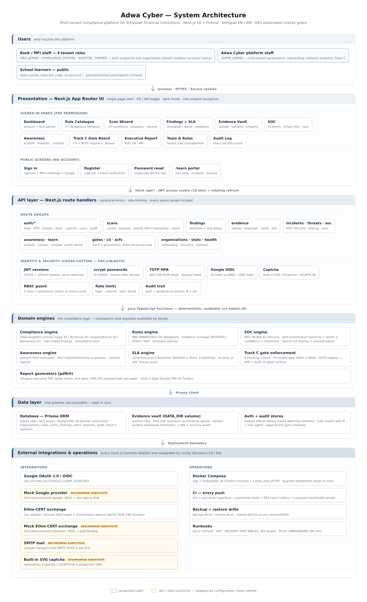

# Adwa Sec — Architecture

> Living document. It describes the architecture as built today, the
> invariants that must survive any change, and the optimization path for when
> the platform grows more sophisticated. Companion documents:
> `README.md` (product overview), `docs/DECISIONS.md` (decision log),
> `docs/VAPT.md` / `docs/AUTH.md` (module references).

## 1. Shape: a modular monolith (deliberately)

Adwa Sec is **one Next.js 16 application** with all domain logic in-process —
no microservices, no message bus, no separate engine tier. That is a choice,
not an accident:

- **Regulator-facing determinism.** Every engine is pure TypeScript that
  can be read end-to-end by an auditor; results are reproducible and every
  input is stored (scans, sync runs, gate events).
- **One deployable** for a pilot-stage team to operate: `docker compose up`
  brings up app + PostgreSQL + Caddy and nothing else.
- **The split that matters is inside the process**: route handlers stay thin,
  domain engines own the logic, Prisma owns persistence. The boundaries that
  a future split would cut along (per-domain modules, below) already exist
  as code seams.

## 2. Layer map

Six layers (see the diagram, regenerated with
`python3 scripts/render-architecture.py`):

| Layer | Where it lives | Responsibility |
|---|---|---|
| Users | — | tenant staff (4 roles), platform staff, public learners |
| Presentation | `src/app/**`, `src/components/**` | one bilingual SPA shell, per-module themed tabs, role-scoped panes |
| API + identity | `src/app/api/**` + `src/lib/auth/**` | route handlers, RBAC guard, JWT session rotation, MFA, captcha, rate limits, audit |
| Domain engines | `src/lib/{vapt,soc,ethio,awareness,compliance,governance}` | all business logic (see §3) |
| Data | `prisma/schema.prisma`, `src/lib/db.ts`, `DATA_DIR` | SQLite dev / PostgreSQL prod, SHA-256-anchored evidence vault, audit stores |
| Integrations & ops | connectors in the domain modules, `mini-services/`, Docker | live feeds, national exchange, OAuth, SMTP, Caddy, CI |

## 3. Domain module map (`src/lib`)

The domain layer is organized as **six domain folders + a platform core**.
Platform core may never import from a domain; a domain may import the
platform core and other domains' *exported* modules, but never reach into
another domain's internals. Dependency direction is acyclic and enforced by
review (typecheck keeps it honest).

| Folder | Modules | Domain |
|---|---|---|
| *(root)* | `db`, `env`, `api-error`, `utils`, `i18n`, `tab-theme`, `auth-client`, `feed-kernel`, `auth/*` | **Platform core** — database handle, boot-time env validation, canonical errors, bilingual runtime, identity, shared feed fetch/cache policy (`feed-kernel.ts`: every outbound feed request goes through `fetchWithTimeout` — no-store, hard timeout, identifying User-Agent — plus `makeTtlCache`) |
| `vapt/` | `vapt-engine`, `vapt-netengine`, `vapt-snmp`, `vapt-db-audit`, `vapt-easm`, `vapt-checks`, `vapt-cve-feed`, `vapt-epss`, `vapt-scope`, `vapt-audit`, `vapt-data` (+ feed snapshot), `vapt-ad-engine`, `vapt-ad-paths`, `vapt-bid-matrix` | **VAPT Center** — real network/TLS/banner DAST, credentialed SNMP/MongoDB/MariaDB audits, CT-log EASM, CVE/EPSS/KEV enrichment, authorization gate, hash-chained audit |
| `soc/` | `soc-engine`, `intel-feeds` (+ `intel-snapshots/`) | **SOC / threat intelligence** — NIST 800-61 lifecycle, public-feed connectors (CISA KEV, abuse.ch URLhaus/ThreatFox, Spamhaus DROP, AlienVault OTX), GreyNoise/VirusTotal enrichment, MISP private exchange, national-exchange sync |
| `ethio/` | `ethiocert-client`, `ethiocert-web`, `ethiocert-feed`, `ethio-landscape` (+ `ethio-snapshots/`) | **Ethiopian ecosystem** — Ethio-CERT public API + web adapters (bilingual, INSA headlines), national legal corpus, ITU GCI posture, NBE directives |
| `awareness/` | `awareness-data`, `awareness-engine`, `awareness-tools`, `awareness-server` | **Awareness platform** — Amharic-first curriculum, RQ2 RCT evaluation, safe-browsing tools, public learner portal |
| `compliance/` | `engine`, `rules-data`, `nbe-rules-data`, `rules-engine`, `evidence`, `evidence-shared`, `sla`, `report-pdf` | **Compliance core** — 47 Proclamation obligations, NBE 30-obligation rules, pillar scoring, evidence coverage, remediation SLA, bilingual executive PDF |
| `governance/` | `gates`, `acfs-gates`, `cii-engine`, `gate-evidence`, `gate-dossier-pdf` | **Track C governance** — gate board, ACFS preconditions, CII monitoring register, funder dossier PDF |

Snapshots (`vapt/vapt-feed-snapshot.json`, `soc/intel-snapshots/`,
`ethio/ethio-snapshots/`) are *captured from the real sources* by
`bun run vapt:epss` / `intel:snapshots` / `ethio:snapshot` and bundled as the
offline fallback — never the primary source.

## 4. Invariants (must survive every change)

1. **The honesty pattern.** Every externally-sourced table carries a source
   column (`LIVE — <source> — <ts>` or `SNAPSHOT — as-of …`) and a degraded
   mode is labelled, never silently served as live. Network failure → last
   good snapshot with its date.
2. **Authorization first.** No scan leaves the platform outside an approved
   scope with owner, written-authorization note and validity window; the
   check is at the API layer, not the UI. CII monitoring is doubly gated
   (MOU × INSA licence) and gated writes return 409 + audit.
3. **Tenant isolation is server-side.** Every query is scoped by
   `organizationId`; read-only roles get 403, not hidden buttons; the
   cross-tenant probes in the battery verify it against the real API.
4. **Append-only, hash-chained audit.** Auth events, VAPT scan runs, gate
   timelines, national-exchange sync receipts (SHA-256 payload proofs) are
   written once and never mutated.
5. **Engines are pure and deterministic.** Scoring, prioritisation, SLA
   computation have no IO; every input they used is persisted next to the
   result. This is what makes results defensible to a regulator.
6. **Fail fast in production.** `src/lib/env.ts` refuses to boot with an
   invalid `DATABASE_URL` or weak/missing `AUTH_SECRET`.

## 5. The connector pattern

Every external source (NVD, FIRST EPSS, CISA KEV, abuse.ch, Spamhaus,
AlienVault OTX, MISP, VirusTotal, GreyNoise, Ethio-CERT API/web, INSA web)
implements the same shape:

- **Fetch policy** — explicit timeout, retry with backoff, per-source rate
  limit, never blocks a user request on a third party.
- **TTL cache** — per-connector (60 s … 6 h) so repeat views don't re-fetch.
- **Snapshot fallback** — bundled capture from the real source, `asOf`
  labelled, with a kill switch env (`ETHIO_WEB_OFF`, unset URL ⇒ fixture).
- **Provenance on every row** — source + timestamp; sync runs are recorded
  with receipt ids into the hash-chained audit log.
- **Keys only in env** — never in the repository; absence of a key degrades
  to an honest "key required" state, never a fabricated run.

A shared kernel (`src/lib/feed-kernel.ts`) owns the mechanical half —
`fetchWithTimeout` (no-store, hard timeout, identifying User-Agent) and
`makeTtlCache` — and every connector above uses it; the domain-specific
half (parsing, snapshot fallback, honesty labels) stays in the owning
domain module, deliberately.

**The bindings registry (Phase 3)** extends the same honesty pattern to the
binding layer itself: one observable surface for every external integration.
The split follows the platform/domain rule exactly:

- `src/lib/bindings.ts` (platform core, pure) — the descriptor model, the
  closed status set (`live | mock | fixture | snapshot | unconfigured |
  disabled`), summary arithmetic and presentation metadata. It imports from
  **no domain**; it turns a plain `BindingInputs` record (booleans,
  endpoint hosts, as-of dates — never secret values) into the registry.
- The **app layer** composes the inputs — the API route
  (`src/app/api/system/bindings/route.ts`, SUPER_ADMIN via `orgs:manage`)
  and the ops CLI (`scripts/bindings-report.ts`, `bun run bindings:report`,
  no app needed) both read the same env-driven status functions the live
  code paths use (`auth/google`, `auth/mail`, `ethio` clients,
  `soc/intel-feeds`, `vapt/epss`), so the registry can never disagree with
  reality.

Operator guide: `docs/PRODUCTION_BINDINGS.md` (the ordered go-live
checklist — Google SSO, SMTP, the Ethio-CERT exchange, keyed feeds, MISP,
cron snapshot refresh, kill-switch rollback posture).

## 6. Scaling evolution — what to change, and when

The platform is built for a pilot; this is the planned, ordered evolution as
load grows. **Each step is triggered by a real signal, not by fashion.**

| Signal (when this hurts) | Move | Notes |
|---|---|---|
| SQLite write contention, >≈50k evidence rows or multi-GB DB | Switch provider to PostgreSQL | `prisma/schema.postgres.prisma` is kept in sync; Docker path already runs it; change `DATABASE_URL` + provider |
| A second app instance / HA | Move login rate limiter + captcha store to Redis (`ioredis`), keep JWT stateless | in-memory limiter is single-instance by design (documented); sessions are already rotating refresh tokens in DB |
| Feed-sync volume / freshness demands | Move scheduled syncs off the request path: a worker (cron-driven `bun` script in the compose, or a queue) calling the same engine functions | sync runs are already receipted and idempotent — the worker just reuses them |
| Long scans blocking requests | Separate scan worker with its own throttle pool + job table (a `ScanJob` queue) | engines are already pure functions over a scope; the vuln-lab stays as the CI target |
| Evidence volume | Object storage (S3-compatible) behind the existing `DATA_DIR` interface | checksum anchoring stays; only the file store changes |
| Multi-region / national scale | Split the monolith along §3 seams (soc/ + ethio/ first — they are stateless-sync), keep compliance/ local | the seams are the module boundaries, so this is a move, not a rewrite |

**Deliberately not planned:** Kubernetes, a service mesh, or event streaming.
A national-scale Ethiopian deployment has stronger constraints on auditable
simplicity than on elastic scale.

## 7. Near-term refactoring roadmap (post-pilot)

1. ~~**Feed kernel**~~ — **done**: `src/lib/feed-kernel.ts` (`fetchWithTimeout` + `makeTtlCache` + `isTimeout`) is the single policy used by the Ethio-CERT web/exchange adapters, EPSS and every intel-feed connector; new connectors should import it instead of hand-rolling a fetch wrapper.
2. **Service layer for routes** — thin `guard → service → Prisma` wrappers
   so route handlers stop repeating auth/tenant checks; purely mechanical.
3. **Open API surface** — a versioned, documented REST contract (OpenAPI
   spec generated from the route handlers) for NBE-side integration.

## 8. Development topologies

| Topology | What runs |
|---|---|
| Dev stack | `next dev` :3000 · mock Google :3010 · mock Ethio-CERT :3020 · mock MISP :3030 · vuln-lab :3060 · Caddy gateway :81 (`Caddyfile`, resolves the `XTransformPort` path convention used by the Google suite) |
| Production standalone | `bun .next/standalone/server.js` behind Caddy/nginx TLS |
| Docker Compose | app + PostgreSQL 16 + Caddy (automatic HTTPS), migrations + guarded seeds on boot |

The mini-services are deterministic test doubles (decisions D3/D4): every
mock has a real counterpart selected purely by environment variables, and the
UI honestly reports which is active.

## 9. Test architecture

- **API battery** — 14 suites, 643 checks, against the live dev stack
  (`bash scripts/run-api-tests.sh`): fresh server per suite (the login rate
  limiter is per-process by design), per-suite reseeding, binding suites
  (Ethio-CERT, MISP) restart the app carrying the binding env and the next
  suite's restart returns to the honest unconfigured default.
- **Auth battery** — 4 suites, 180 checks (`bash scripts/ci-run-auth-suites.sh`),
  including the full Google OAuth redirect chain through the :81 gateway.
- **Recovery battery** — 38 checks (password reset, email verification,
  logged-in change).
- **Unit suites** — connector adapters and engines (Ethio-CERT web 72,
  VAPT engines 36, awareness tools 47) run without a server.
- **CI** (`ci.yml`) — lint → zero-error typecheck (`tsconfig.ci.json`, src/)
  → production build → full battery → Docker compose boot/health smoke.

Live-internet checks (public feeds, CT-log EASM) tolerate the sandbox's
occasional network flakes by design: they re-run, and their failure never
fabricates a pass.
